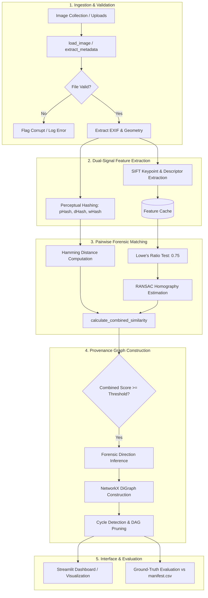

# Image Provenance Graph Reconstruction — System Architecture

A multimedia forensic framework for visual lineage analysis. This document details the technical architecture, mathematical foundations, data pipelines, and component design of the system.

---

## 1. Executive Summary & Problem Formulation

In digital forensics, **Image Provenance Analysis** aims to reconstruct the evolutionary history (ancestral graph) of a collection of visually related images. When an image is published online, it is frequently republished in modified forms: downscaled for mobile thumbnails, cropped to emphasize subjects, re-compressed with aggressive JPEG quantization for social media platforms, or color-adjusted.

```
       [Original Camera Image] (800x600, High Quality, EXIF intact)
             /                   \
            v                     v
   [Cropped Variant]     [Resized Variant] (400x300)
    (Field-of-View crop)          |
                                  v
                       [Compressed Web Copy] (Quality 20)
```

### The Forensic Challenge
1. **Metadata Stripping & Tampering:** Social networks strip EXIF headers (`DateTime`, `Camera Model`, `GPSInfo`), rendering timestamps unreliable.
2. **Information Loss:** Transformations like downsampling, JPEG compression, and cropping permanently destroy pixel information.
3. **Similarity $\neq$ Lineage:** High visual similarity indicates that two images share content, but does not indicate *which image gave birth to the other*.
4. **Computational Complexity:** Naive pairwise comparisons scale as $\mathcal{O}(N^2)$. Local descriptor extraction must be optimized to prevent redundant computation.

---

## 2. End-to-End System Architecture

The pipeline consists of five interconnected modules:



---

## 3. Detailed Component Breakdown

### Stage 1: Ingestion, Validation & Metadata Extraction (`src/metadata.py`)
- **Input:** Filepaths or uploaded image byte streams.
- **Validation:** Calls `PIL.Image.verify()` and `PIL.Image.open().load()` within isolated context managers to trap `UnidentifiedImageError`, truncated headers, zero-byte files, and non-image formats without crashing.
- **Geometric Attributes:** Computes dimensions ($W, H$), aspect ratio ($W/H$), total megapixels ($W \times H / 10^6$), and file size.
- **EXIF Decoding:** Decodes standard EXIF tags via `PIL.ExifTags.TAGS` and extended IFDs (`DateTimeOriginal`, `Make`, `Model`, `Software`, `Orientation`, `GPSInfo`). Non-serializable types (`IFDRational`, byte strings) are normalized.
- **Integrity Fingerprint:** Computes SHA-256 hash for exact duplicate detection.

### Stage 2: Dual-Signal Visual Similarity Computation

The system employs two complementary visual signals: **Global Perceptual Hashing** and **Local Keypoint Geometry**.

#### Signal A: Multi-Scale Perceptual Hashing (`src/hashing.py`)
Computes frequency-domain and gradient hashes using `ImageHash`:
1. **pHash (DCT-based):** Computes Discrete Cosine Transform of 32x32 grayscale representation, keeping top 8x8 low frequencies. Highly resilient to JPEG recompression and minor brightness shifts.
2. **dHash (Gradient-based):** Computes row-wise gradient differences. Sensitive to global structural shifts.
3. **wHash (Wavelet-based):** Uses discrete wavelet transform (DWT). Resilient to high-frequency noise.

Hamming distance $D_H \in [0, 64]$ is mapped to a normalized score $S_{\text{hash}} \in [0.0, 1.0]$:
$$S_{\text{phash}} = \max\left(0.0, 1.0 - \frac{D_H}{32}\right)$$
$$S_{\text{composite}} = 0.5 \cdot S_{\text{phash}} + 0.3 \cdot S_{\text{whash}} + 0.2 \cdot S_{\text{dhash}}$$

#### Signal B: SIFT Local Features & RANSAC Geometry (`src/matching.py`)
Scale-Invariant Feature Transform (SIFT) provides local scale and rotation invariance:
1. **Feature Caching:** A `FeatureExtractor` caches keypoints and 128-dimensional descriptors per image, ensuring $\mathcal{O}(N)$ extractions rather than $\mathcal{O}(N^2)$.
2. **Lowe's Ratio Test:** Descriptors are matched using Euclidean distance via $k$-NN ($k=2$). A match $m$ is retained only if:
   $$\|d_1 - d_2\| < 0.75 \cdot \|d_1 - d_3\|$$
3. **RANSAC Geometric Verification:** With $\ge 4$ good matches, homography matrix $H$ is estimated via RANSAC with reprojection error threshold $\tau = 5.0$ pixels:
   $$\mathbf{x}' \sim H \mathbf{x}$$
   The count of geometrically consistent inliers ($N_{\text{inliers}}$) filters out accidental visual resemblances.
4. **SIFT Similarity Score:**
   $$S_{\text{sift}} = 0.65 \cdot \min\left(1.0, \frac{N_{\text{inliers}}}{25}\right) + 0.35 \cdot \min\left(1.0, \frac{3 \cdot N_{\text{inliers}}}{\min(K_1, K_2)}\right)$$

#### Signal Fusion (Combined Similarity Score)
Global hashing and local SIFT have reciprocal strengths and weaknesses:
- **Resizing & Recompression:** Both signals perform strongly.
- **Cropping (The Crop Trap):** Global pHash collapses ($D_H \ge 28$, $S_{\text{hash}} < 0.15$) because cropping alters global spatial frequencies. SIFT, however, detects dozens of inliers inside the overlapping window.

The fused score $S \in [0.0, 1.0]$ is computed as:
$$S = \begin{cases}
\max(0.45 S_{\text{hash}} + 0.55 S_{\text{sift}},\, 0.85 S_{\text{sift}} + 0.15 S_{\text{hash}}) & \text{if } N_{\text{inliers}} \ge 15 \text{ and } S_{\text{sift}} \ge 0.6 \\
\max(0.45 S_{\text{hash}} + 0.55 S_{\text{sift}},\, 0.90 + 0.10 S_{\text{sift}}) & \text{if } D_H \le 2 \text{ and } N_{\text{inliers}} \ge 6 \\
\min(0.45 S_{\text{hash}} + 0.55 S_{\text{sift}},\, 0.20) & \text{if } N_{\text{inliers}} < 4 \text{ and } S_{\text{hash}} < 0.65 \\
0.45 S_{\text{hash}} + 0.55 S_{\text{sift}} & \text{otherwise}
\end{cases}$$

---

### Stage 3: Provenance Graph Reconstruction & Direction Heuristics (`src/graph_builder.py`)

A candidate edge is instantiated when $S \ge \theta$ (default $\theta = 0.45$). The lineage direction between image $A$ and image $B$ is estimated via four forensic voting criteria:

| Forensic Clue | Physical Principle | Direction Evidence | Weight |
|---|---|---|---|
| **Pixel Resolution** | Downsampling permanently destroys high-frequency frequencies. Upsampling cannot restore true entropy. | $\text{Area}(A) \ge 1.15 \times \text{Area}(B) \implies A \to B$ | 2.0 |
| **Field-of-View Crop** | Cropping removes peripheral pixels; cannot be recovered without outpainting. | High SIFT inliers + pHash divergence + $\text{Area}(A) > \text{Area}(B) \implies A \to B$ | 2.5 |
| **JPEG Quantization Loss** | Heavy recompression drops byte size at identical resolution. | $\text{Size}(A) \ge 1.6 \times \text{Size}(B)$ with equal dimensions $\implies A \to B$ | 1.5 |
| **EXIF Capture Timestamps** | Chronological ordering of original shutter actuation. | $T_{\text{capture}}(A) < T_{\text{capture}}(B) \implies A \to B$ | 1.0 |

#### Ambiguity Handling (`UNKNOWN` Direction)
When directional evidence is balanced ($|\text{votes}_{A \to B} - \text{votes}_{B \to A}| < 1.0$) or no clues exist (e.g., identical dimensions and stripped EXIF), the direction is designated as **`UNKNOWN`** with a low confidence score ($0.30 - 0.40$). The graph renders these edges with dashed lines rather than asserting unprovable parentage.

#### Cycle Resolution
Real-world visual lineage is acyclic. If directed inferences form a cycle ($A \to B \to C \to A$), the cycle is detected using Johnson's algorithm (`nx.simple_cycles`) and the edge with the lowest confidence score is pruned.

---

### Stage 4: Ground-Truth Evaluation Framework (`src/evaluation.py`)

Evaluation compares the reconstructed graph against a ground-truth manifest ([data/manifest.csv](file:///home/pixels/Documents/Projects/ImageProvenanceGraph/data/manifest.csv)):

1. **Pairwise Detection (Undirected):**
   - **True Positive (TP):** Predicted connection between images sharing the same root.
   - **False Positive (FP):** Predicted connection between unrelated images / distractors.
   - **False Negative (FN):** Missing connection between related images.
   $$\text{Precision} = \frac{TP}{TP + FP}, \quad \text{Recall} = \frac{TP}{TP + FN}, \quad F_1 = \frac{2 P R}{P + R}$$

2. **Directed Lineage (Parent $\to$ Child):**
   - Evaluates whether the predicted directed edge $u \to v$ matches the exact ground-truth parent $u$ of child $v$.

3. **Transformation Robustness Breakdown:**
   - Computes separate recall metrics for:
     - Resizing ($50\%$ scale)
     - Central Cropping ($60\%$ crop)
     - JPEG Recompression (Quality 20)
     - Brightness adjustment ($+35\%$)

---

## 4. Key Data Structures

### `ImageMetadata` (`src/metadata.py`)
```python
@dataclass
class ImageMetadata:
    filename: str
    filepath: str
    is_valid: bool
    error_message: Optional[str] = None
    file_size_bytes: int = 0
    file_size_human: str = "0 B"
    format: Optional[str] = None
    mode: Optional[str] = None
    width: Optional[int] = None
    height: Optional[int] = None
    aspect_ratio: Optional[float] = None
    megapixels: Optional[float] = None
    exif_data: Dict[str, Any] = field(default_factory=dict)
    exif_summary: str = "None"
    sha256: Optional[str] = None
    last_modified: Optional[str] = None
```

### `PairwiseMatchResult` (`src/matching.py`)
```python
@dataclass
class PairwiseMatchResult:
    img1: str
    img2: str
    path1: str
    path2: str
    phash_dist: int
    hash_similarity: float
    num_kp1: int
    num_kp2: int
    num_raw_matches: int
    num_good_matches: int
    num_inliers: int
    inlier_ratio: float
    sift_similarity: float
    combined_score: float
    clues: Dict[str, Any] = field(default_factory=dict)
```

---

## 5. Limitations & Future Extensions

1. **Star vs. Chain Ambiguity:** When all variants are derived from an original (star topology), smaller variants can be mistaken for children of larger variants if both share identical content.
2. **Featureless Images:** SIFT requires local contrast and corner/edge textures. Plain color backgrounds or smooth graphics produce sparse keypoints.
3. **Advanced Tampering:** Splicing, composition, or generative inpainting may require dense optical flow or patch-level mutual information analysis.
